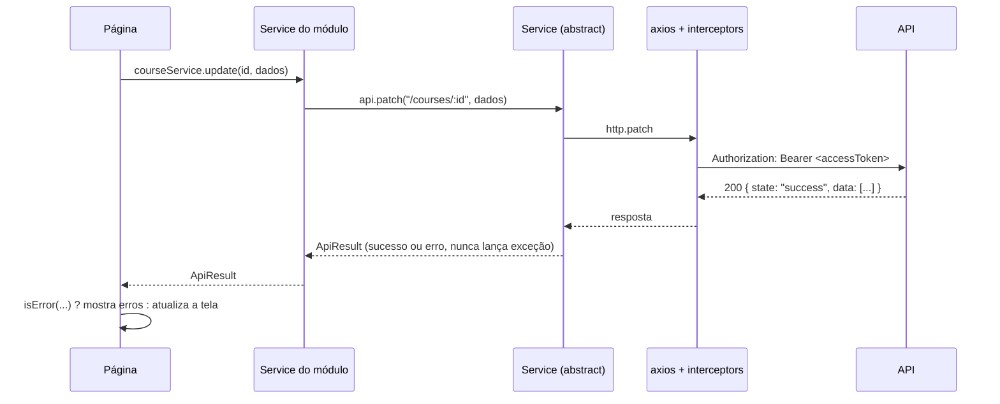

# Organizador de Estudos — Frontend

Vue 3 + TypeScript + Vite + **Vuetify 4** + Pinia + Vue Router + Axios + Chart.js.

## 1. Rodando localmente

Com a API rodando (veja o README do backend — inclui Postgres e o simulador do B2 via Docker):

```bash
npm install
# .env -> VITE_BASE_URL=http://localhost:3000/api/v1
npm run dev        # http://localhost:5173
npm run build      # checagem de tipos (vue-tsc) + build de produção
```

Acesse `http://localhost:5173`, cadastre um aluno ou entre com o administrador criado pelo seed (`admin` / `Admin12345`).
A origem do front precisa estar em `CORS_ORIGINS` no `.env` da API (padrão `http://localhost:5173`).

## 2. Estrutura

```
src/
├── main.ts              cria o app, restaura a sessão e só então monta o router
├── App.vue              <v-app> + snackbar e diálogo de confirmação globais
├── layouts/AppLayout    menu lateral, barra superior, cronômetro e tema
├── router/              RouteProps (nomes/caminhos), routes, guardas
├── services/
│   ├── abstract/        Service: get/post/put/patch/delete devolvendo ApiResult
│   └── api/             instância do axios, interceptors, type guards e modelos da resposta
├── stores/              estado global: estrutura de cursos, notificações, confirmação
├── composables/         useApi, useLatest, useLeaveGuard
├── components/          ScopeSelect, ScopeLabel, PageHeader, StatCard, EmptyState, gráficos
├── utils/               datas, regras de validação, erros da API, parâmetros, notas
└── modules/<módulo>/
    ├── models/DTO/          tipos das requisições e respostas
    ├── models/Types/        uniões de valores (ex.: TicketStatus)
    ├── models/constants/    rótulos e cores exibidos na tela
    ├── models/interfaces/   contrato do service do módulo
    ├── services/            classe do service (ex.: CourseService) e sua instância
    ├── stores/              stores do módulo (auth, cronômetro)
    ├── components/          componentes do módulo
    └── pages/               telas
```

## 3. Fluxo de uma requisição



1. A **página** chama o service do módulo (ex.: `courseService.update`).
2. O **service do módulo** monta a URL e o corpo e chama o `Service` abstrato.
3. O **`Service`** usa a instância do axios e transforma qualquer resposta em `ApiResult`: `{ state: "success", data: [] }` ou `{ state: "error", data: [{ field, message }] }`. Respostas 204 viram sucesso com `data: []`.
4. Na página, `isError(resposta)` decide o caminho. Erros com `field` vão para o campo do formulário (`splitApiErrors`); os demais aparecem em alerta ou no snackbar.
5. O composable **`useApi`** encurta esse padrão: `run(...)` devolve os dados ou `null` e já mostra o erro no snackbar.

## 4. Autenticação e sessão

1. **Login** (`authStore.login`): guarda o `accessToken` e a expiração da sessão (em segundos) na store e carrega o usuário (`/users/me`). O refresh token fica no cookie httpOnly `rToken`, que o JavaScript não lê.
2. **Interceptor de requisição** (`services/api/api.ts`): coloca o `Authorization: Bearer`. Se a sessão já expirou, faz logout.
3. **Interceptor de resposta**: num **401**, chama `/auth/refresh` uma única vez (requisições simultâneas aguardam o mesmo refresh) e repete a requisição original. Se o refresh falhar, faz logout e volta ao login.
4. **Recarregar a página**: `main.ts` chama `restoreSession()` (refresh pelo cookie) antes de montar o router, então o usuário continua logado.
5. **Guardas de rota** (`router/index.ts`): `requiresAuth` exige login (e guarda o destino em `?redirect=`), `guestOnly` tira usuários logados das telas de login/cadastro e `requiresAdmin` limita o painel ao perfil ADMIN.
6. **Esqueci a senha**: a tela envia o e-mail; o link recebido abre `/reset-password?token=...`, onde a nova senha é definida.

## 5. Uso das telas

| Tela | Rota | O que faz |
|---|---|---|
| Início | `/dashboard` | Tempo estudado hoje e na semana, sequência, média nas atividades, cronômetro, gráfico de 14 dias, metas |
| Cursos | `/courses`, `/courses/:id` | CRUD de cursos; no detalhe, módulos e disciplinas e o botão "Estudar agora" |
| Sessões de estudo | `/study` | Cronômetro, registro manual e histórico (editar/excluir) |
| Metas | `/goals` | Metas com barra de progresso e filtro por status |
| Estatísticas | `/stats` | Período (7/30/90 dias ou personalizado), filtro por escopo, gráficos e rendimento nas atividades |
| Banco de questões | `/questions` | Questões de múltipla escolha e V/F, filtradas por escopo e busca |
| Atividades | `/activities`, `/activities/:id`, `/activities/:id/answer`, `/attempts/:id` | Montar a atividade, responder uma questão por vez e ver a correção |
| Bloco de notas | `/notes` | Lista + editor com salvamento automático |
| Arquivos | `/files` | Upload com progresso (arrastar e soltar), visualização de imagem/vídeo/áudio/PDF/texto e download |
| Suporte | `/support`, `/support/:id` | Abrir chamado com imagens e conversar com o suporte |
| Perfil | `/profile` | Dados, troca de senha e exclusão da conta |
| Painel admin | `/admin`, `/admin/users`, `/admin/users/:id`, `/admin/tickets` | Indicadores, usuários, acompanhamento do aluno e atendimento dos chamados |

### Comportamentos comuns
- **Seletor de escopo** (`ScopeSelect`): curso → módulo → disciplina em cascata; emite apenas o nível mais específico escolhido, que é o formato esperado pela API.
- **Cache da estrutura** (`structure.store`): cursos, módulos e disciplinas do usuário são carregados uma vez no layout e reaproveitados nos seletores e nos nomes exibidos; após criar/editar/excluir, a página chama `structure.reload()`.
- **Cronômetro** (`timer.store`): a sessão em andamento aparece na barra superior em todas as telas.
- **Arquivos**: para visualizar ou baixar, a página pede links temporários (`/files/:id/access`), porque `<video>`, `` e `<iframe>` não enviam o token.
- **Painel admin**: `/admin/tickets` reaproveita as páginas de suporte com `meta.adminMode`, que libera a troca de status e mostra os chamados de todos os usuários.
- **Datas**: a API recebe datas no formato `dd/mm/aaaa`; os campos usam `input type="date"` e convertem com `utils/date.ts`.
