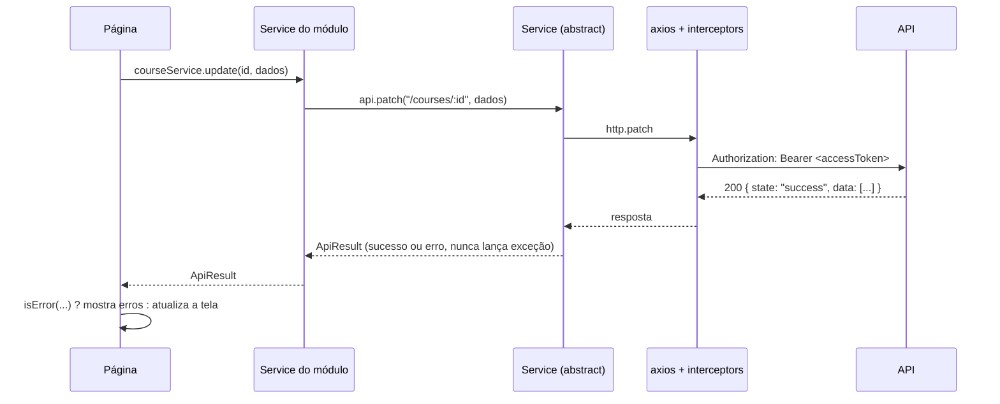

# Organizador de Estudos — Frontend

Vue 3 + TypeScript + Vite + **Vuetify 4** + Pinia + Vue Router + Axios + Chart.js.

## 1. Rodando localmente

Com a API rodando (veja o README do backend — inclui Postgres e o simulador do B2 via Docker):

```bash
npm install
# .env -> VITE_BASE_URL=http://localhost:3000/api/v1
npm run dev        # http://localhost:5173
npm run build      # checagem de tipos (vue-tsc) + build de produção
```

Acesse `http://localhost:5173`, cadastre um aluno ou entre com o administrador criado pelo seed (`admin` / `Admin12345`).
A origem do front precisa estar em `CORS_ORIGINS` no `.env` da API (padrão `http://localhost:5173`).

## 2. Estrutura

```
src/
├── main.ts              cria o app, restaura a sessão e só então monta o router
├── App.vue              <v-app> + snackbar e diálogo de confirmação globais
├── layouts/AppLayout    menu lateral, barra superior, cronômetro e tema (rotas com meta.focus escondem menu e barra)
├── router/              RouteProps (nomes/caminhos), routes, guardas
├── services/
│   ├── abstract/        Service: get/post/put/patch/delete devolvendo ApiResult
│   └── api/             instância do axios, interceptors, type guards e modelos da resposta
├── stores/              estado global: estrutura de cursos, notificações, confirmação
├── composables/         useApi, useLatest, useLeaveGuard, useScopeContent, useHubRoute, useReaderRoute
├── components/          ScopeSelect, ScopeLabel, PageHeader, StatCard, EmptyState, MarkdownView, MarkdownEditor, gráficos
├── utils/               datas, regras de validação, erros da API, parâmetros, notas, escopo, Markdown
└── modules/<módulo>/
    ├── models/DTO/          tipos das requisições e respostas
    ├── models/Types/        uniões de valores (ex.: TicketStatus)
    ├── models/constants/    rótulos e cores exibidos na tela
    ├── models/interfaces/   contrato do service do módulo
    ├── services/            classe do service (ex.: CourseService) e sua instância
    ├── stores/              stores do módulo (auth, cronômetro)
    ├── utils/               funções do módulo (ex.: study/utils/readerOrder.ts, files/utils/fileKind.ts)
    ├── components/          componentes do módulo (inclusive os painéis reaproveitados em várias telas)
    └── pages/               telas
```

## 3. Fluxo de uma requisição



1. A **página** chama o service do módulo (ex.: `courseService.update`).
2. O **service do módulo** monta a URL e o corpo e chama o `Service` abstrato.
3. O **`Service`** usa a instância do axios e transforma qualquer resposta em `ApiResult`: `{ state: "success", data: [] }` ou `{ state: "error", data: [{ field, message }] }`. Respostas 204 viram sucesso com `data: []`.
4. Na página, `isError(resposta)` decide o caminho. Erros com `field` vão para o campo do formulário (`splitApiErrors`); os demais aparecem em alerta ou no snackbar.
5. O composable **`useApi`** encurta esse padrão: `run(...)` devolve os dados ou `null` e já mostra o erro no snackbar.

## 4. Autenticação e sessão

1. **Login** (`authStore.login`): guarda o `accessToken` e a expiração da sessão (em segundos) na store e carrega o usuário (`/users/me`). O refresh token fica no cookie httpOnly `rToken`, que o JavaScript não lê.
2. **Interceptor de requisição** (`services/api/api.ts`): coloca o `Authorization: Bearer`. Se a sessão já expirou, faz logout.
3. **Interceptor de resposta**: num **401**, chama `/auth/refresh` uma única vez (requisições simultâneas aguardam o mesmo refresh) e repete a requisição original. Se o refresh falhar, faz logout e volta ao login.
4. **Recarregar a página**: `main.ts` chama `restoreSession()` (refresh pelo cookie) antes de montar o router, então o usuário continua logado.
5. **Guardas de rota** (`router/index.ts`): `requiresAuth` exige login (e guarda o destino em `?redirect=`), `guestOnly` tira usuários logados das telas de login/cadastro e `requiresAdmin` limita o painel ao perfil ADMIN.
6. **Esqueci a senha**: a tela envia o e-mail; o link recebido abre `/reset-password?token=...`, onde a nova senha é definida.

## 5. Uso das telas

| Tela | Rota | O que faz |
|---|---|---|
| Início | `/dashboard` | Tempo estudado hoje e na semana, sequência, média nas atividades, cronômetro, gráfico de 14 dias, metas e a lista "Meus cursos" |
| Cursos | `/courses` | Lista e CRUD de cursos |
| Página de estudo | `/courses/:id`, `/courses/:id/modules/:moduleId`, `/courses/:id/modules/:moduleId/disciplines/:disciplineId` | Centraliza tudo o que está vinculado ao curso, módulo ou disciplina (e aos níveis dentro dele): visão geral, materiais, notas, questões, atividades, metas e sessões, em abas (`?tab=`). A árvore lateral troca o nível mantendo a aba. "Estudar" abre o modo estudo do nível; "Cronômetro" inicia a sessão sem sair da página (vira "Finalizar estudo" enquanto roda) |
| Modo estudo | `/courses/:id/study`, `.../modules/:moduleId/study`, `.../disciplines/:disciplineId/study` | Tela limpa (sem menu) para estudar o nível aberto: notas (Markdown) e materiais em sequência, na ordem de inclusão, com seções por módulo e disciplina. Entre os itens, o botão **+** insere uma nota ou um material naquela posição. No computador (≥ 1280 px) a lista fica à esquerda e o painel da direita mostra em cima o vídeo/PDF/áudio escolhido e embaixo a imagem escolhida; no celular tudo aparece em linha e o vídeo em reprodução vira um mini player no canto ao rolar a página. Tem sumário, cronômetro e "Praticar" com as atividades de cada seção |
| Biblioteca | `/library?tab=files\|notes\|questions\|activities` | Os mesmos painéis sem filtro fixo: tudo de todos os cursos e o que está sem vínculo. `/files`, `/notes`, `/questions` e `/activities` redirecionam para a aba correspondente |
| Sessões de estudo | `/study` | Cronômetro, registro manual e histórico (editar/excluir) |
| Metas | `/goals` | Metas com barra de progresso e filtro por status |
| Estatísticas | `/stats` | Período (7/30/90 dias ou personalizado), filtro por escopo, gráficos e rendimento nas atividades |
| Atividade | `/activities/:id`, `/activities/:id/answer`, `/attempts/:id` | Gerenciar a atividade, responder uma questão por vez e ver a correção; "voltar" leva à página de estudo onde ela está vinculada |
| Suporte | `/support`, `/support/:id` | Abrir chamado com imagens e conversar com o suporte |
| Perfil | `/profile` | Dados, troca de senha e exclusão da conta |
| Painel admin | `/admin`, `/admin/users`, `/admin/users/:id`, `/admin/tickets` | Indicadores, usuários, acompanhamento do aluno e atendimento dos chamados |

### Menu lateral
Estudos (Início, Meus cursos com cada curso listado, Biblioteca), Acompanhamento (Sessões de estudo, Metas, Estatísticas), Ajuda (Suporte) e, para o perfil ADMIN, Administração (Painel, Usuários, Chamados).

### Fluxo do modo estudo
1. A página do curso/módulo/disciplina monta o endereço com `useReaderRoute(escopo)`; a rota tem `meta.focus`, então o `AppLayout` some com o menu e a barra.
2. `StudyReaderPage` busca notas e arquivos com o escopo (a API já inclui os níveis de dentro) e todas as atividades, filtradas por `structure.contains`.
3. Monta as seções na ordem da estrutura (curso → módulos → disciplinas). Dentro de cada seção, ordena por `position ?? createdAt`.
4. Cada `ReaderInsert` (o **+**) conhece a posição do item de antes e do de depois e envia a média como `position` ao criar a nota ou enviar o arquivo.
5. `FileInline` só pede o link temporário quando o material chega perto da tela. Com `floatable`, o vídeo em reprodução vira mini player ao sair da tela; com `eager`/`fill`, carrega na hora e ocupa o painel lateral (computador).

### Comportamentos comuns
- **Painéis com escopo**: `FilesPanel`, `NotesPanel`, `QuestionsPanel`, `ActivitiesPanel`, `GoalsPanel` e `StudySessionsPanel` recebem a prop `scope`. Com escopo, listam só o conteúdo daquele nível (e dos níveis dentro dele) e já criam os itens vinculados a ele; sem escopo, mostram tudo com os filtros. Ao alterar algo emitem `changed`, e a página de estudo atualiza os contadores das abas.
- **Ordem do modo estudo**: notas e arquivos têm `position` (opcional). A ordem é `position ?? data de inclusão`; ao inserir entre dois itens, a tela envia a média das posições vizinhas (`modules/study/utils/readerOrder.ts`).
- **Markdown**: notas e arquivos `.md` são renderizados com `marked` e sanitizados com `DOMPurify` antes do `v-html` (`utils/markdown.ts`, `MarkdownView`, `MarkdownEditor`).
- **Navegação**: o `vite.config.ts` pré-otimiza todos os componentes do Vuetify. Sem isso, em modo dev, o Vite descobria componentes novos ao abrir cada tela e recarregava a página no meio da navegação (o clique "não pegava"). Uma barra de progresso no topo aparece se a próxima tela demorar para carregar.
- **Seletor de escopo** (`ScopeSelect`): curso → módulo → disciplina em cascata; emite apenas o nível mais específico escolhido, que é o formato esperado pela API.
- **Cache da estrutura** (`structure.store`): cursos, módulos e disciplinas do usuário são carregados uma vez no layout e reaproveitados nos seletores e nos nomes exibidos; após criar/editar/excluir, a página chama `structure.reload()`.
- **Cronômetro** (`timer.store`): a sessão em andamento aparece na barra superior em todas as telas.
- **Arquivos**: para visualizar ou baixar, a página pede links temporários (`/files/:id/access`), porque `<video>`, `` e `<iframe>` não enviam o token.
- **Painel admin**: `/admin/tickets` reaproveita as páginas de suporte com `meta.adminMode`. No chamado, o admin usa **Atender** (assume o chamado: fica *Em atendimento* e só ele vê), **Transferir** (escolhe outro admin em `GET /admin/admins`), **Alterar status** (qualquer status, inclusive a partir de Respondido) e **Reabrir**. Ao responder um chamado que está com ele, pode manter em atendimento ou enviar como Respondido. A conversa mistura mensagens e o histórico (`events`: recebeu, transferiu, alterou status, encerrado pelo usuário/administrador). A lista tem a coluna Responsável e o filtro "Meus atendimentos".
- **Datas**: a API recebe datas no formato `dd/mm/aaaa`; os campos usam `input type="date"` e convertem com `utils/date.ts`.
